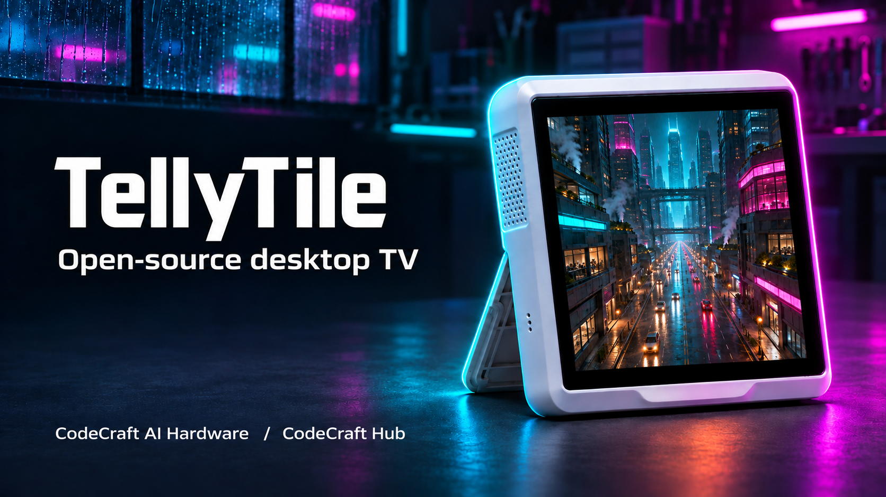

# TellyTile — Open-source desktop TV for SenseCAP Indicator

[简体中文](README.zh_CN.md) · [CodeCraft Hub](https://codecraft.seeed.cc/hub/application) · [CodeCraft AI Hardware](https://github.com/Seeed-Solution/codecraft-ai-hardware)

TellyTile turns a Seeed Studio SenseCAP Indicator into a 4-inch Wi-Fi desktop TV. Watch livestreams, keep a workshop camera in view, or loop a demo on a small screen that fits beside your keyboard.

## What you can do

- **Fill the screen.** On GX, video fills the square display. Tap once for the channel list, playback controls and status. Tap the picture again to hide the controls.
- **Swipe to change channels.** Move between a livestream, a camera feed and a demo clip without reaching for your phone.
- **Run your own lineup.** A streaming service on your computer prepares the video and sends it to the Indicator over Wi-Fi. Add a reSpeaker Lite if you want audio. [Audio companion setup](audio/README.md)

## Get started

You'll need a **SenseCAP Indicator**, USB power, a **2.4 GHz Wi-Fi** network for the device, and a computer on the same local network to run the streaming service.

1. **Choose and flash the firmware for your screen.** The GX build has the fullscreen experience shown here. The DX build uses its earlier layout. Check your panel if you're unsure which to choose. [GX firmware](release-fullscreen-gx/firmware.bin) · [DX firmware](release-receive-deadline-dx/firmware.bin) · [Panel and setup notes](DETAILS.md)
2. **Start the streaming service** on a computer and add a video source you want to watch. Keep its local address and pairing code handy. [Streaming service setup](https://github.com/guolifu/ai-passport-tv/blob/30ba309d5fe77e86154de3ca1b81d457b65bc36f/README.md#3-start-the-service)
3. **Connect to the `TV-SETUP` hotspot** shown on the Indicator. Open [the device setup page](http://192.168.4.1), enter your Wi-Fi, the streaming service address and its pairing code, then save and restart.

Fullscreen live playback and tap-to-show controls were verified on a GX unit. The cover is an illustration of the viewing experience. [GX device test](evidence/indicator-gx-fullscreen.md)

## Explore CodeCraft

Want to see how the display and touch support work or port TellyTile to another board? Start with the board support and examples used in this project. [CodeCraft AI Hardware on GitHub](https://github.com/Seeed-Solution/codecraft-ai-hardware)

Looking for more projects to try on your device? Browse by hardware in the [CodeCraft Hub application gallery](https://codecraft.seeed.cc/hub/application).

[Setup and development notes](DETAILS.md) · [MIT License](LICENSE) · [Software sources and third-party notices](UPSTREAM.md)
